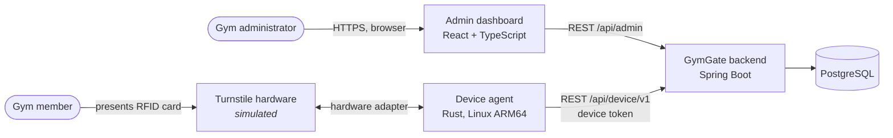
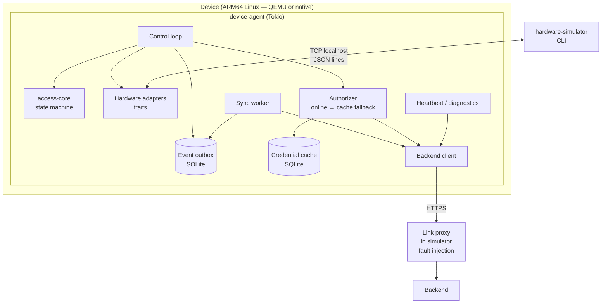
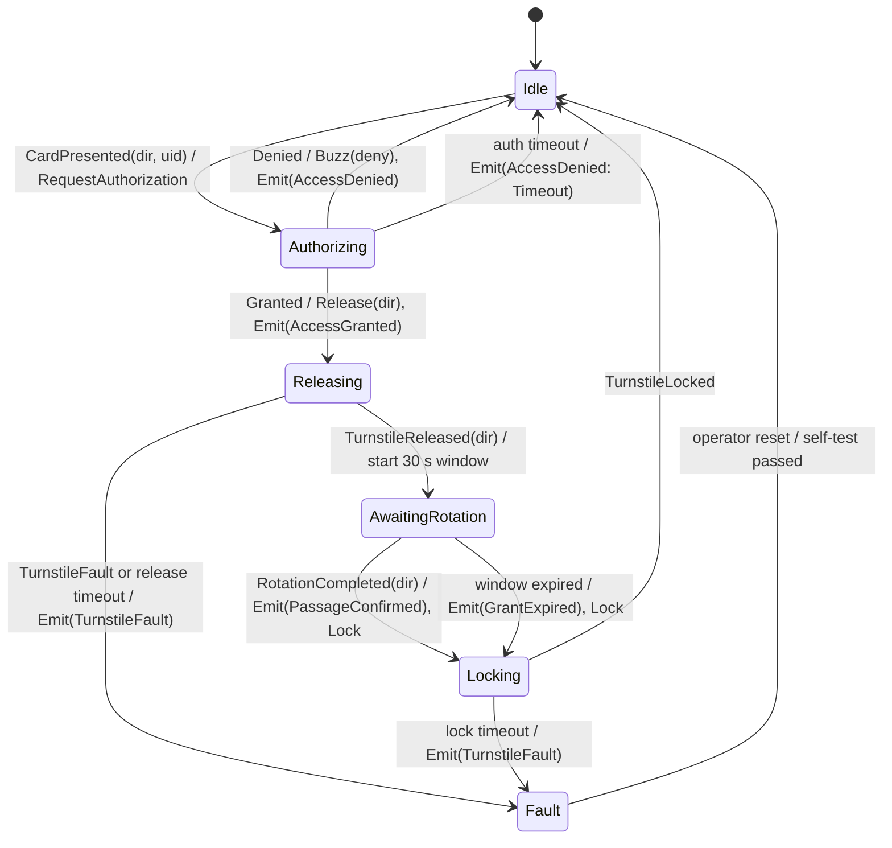

# GymGate — Architecture Proposal

> **Status: ACCEPTED (2026-11-05).** Decisions are recorded as ADR-0002 … ADR-0012 in
> [`decisions/`](decisions/README.md). Most of what is described here is **not implemented yet**;
> see the [roadmap](../roadmap.md). As components are built, the relevant sections move into the
> permanent architecture documents.

## 1. Goals and non-goals

**Goals**

- A simulation-first gym access-control system that runs end-to-end without physical hardware.
- A hardware-independent access-control core that is portable to a future microcontroller (`no_std`) target.
- Explicit, tested behaviour for offline operation, event delivery, device restart and turnstile failure.
- Reproducible builds and tests on a developer machine and in CI.

**Non-goals (first release)**

- Real GPIO / RFID hardware drivers.
- Bare-metal firmware. The core is *designed to be portable* to `no_std`; the device agent is a Linux process.
- Production-grade security (see §9 for what is and is not covered).
- Multi-tenant / multi-gym support, payments, member self-service.

## 2. System context



## 3. Components and repository layout

```
gymgate/
├── device/                      # Cargo workspace
│   ├── access-core/             # pure state machine, no I/O, no_std
│   ├── device-agent/            # Tokio Linux process, adapters, storage, sync
│   └── hardware-simulator/      # separate process: simulated peripherals + CLI
├── backend/                     # Spring Boot modular monolith (Maven)
├── frontend/                    # React + TypeScript + Vite
├── infrastructure/              # docker-compose, QEMU scripts, systemd unit
├── docs/
├── scripts/                     # dev helpers, e2e runner
└── .github/workflows/
```



## 4. The access-core / device-agent boundary

The single most important boundary in the system.

**access-core is a pure ("sans-IO") state machine.** It never performs I/O. It receives
*inputs* and the current monotonic time, and returns *commands* for the outside world to execute.

```rust
// Illustrative shape — final API will be settled in Milestone 1.
pub fn handle(&mut self, input: Input, now: Millis) -> Commands;

enum Input   { CardPresented(Direction, CardUid), Decision(AuthDecision), TurnstileReleased(Direction),
               TurnstileLocked, TurnstileFault, RotationCompleted(Direction), Tick }
enum Command { RequestAuthorization(Direction, CardUid), Release(Direction), Lock, Buzz(Pattern), Emit(DomainEvent) }
```

| access-core (pure, `no_std`) | device-agent (Tokio, Linux) |
|---|---|
| Turnstile/attempt state machine | Reading hardware, executing `Release`/`Lock`/`Buzz` |
| Timeout rules (given `now`) | Providing the clock, scheduling `Tick`s |
| Authorization *decision type* and denial reasons | *Obtaining* a decision: backend call, then cache fallback |
| Offline policy as a pure function (`cache entry + now → decision`) | Storing and refreshing the cache |
| Domain events (`AccessGranted`, `PassageConfirmed`, …) | Persisting events to the outbox and syncing them |
| — | Device lifecycle, restart recovery, diagnostics, logging |

Consequences: the core is unit-testable without mocks, async runtime or clock; it can be
compiled for a bare-metal target in CI to *prove* portability (not to claim a firmware exists).
`CardUid` is a fixed-size value (ISO 14443 UIDs are 4, 7 or 10 bytes), so the core needs no heap.

## 5. Device state machine (draft)

### 5.1 Physical model: bidirectional tripod turnstile

- One turnstile serves both **entry** and **exit**; each direction is released independently.
- A granted card gives **exactly one rotation** in the requested direction.
- The grant is valid for a **rotation window** (default 30 s, configurable). If no rotation happens
  within the window, the grant expires and the turnstile stays locked.
- After one full rotation the turnstile **locks again** in its rest position.
- A rotation sensor reports a completed rotation and its direction. This sensor *is* the passage
  sensor: "passage detected" means "one full rotation completed in the granted direction".
- The turnstile controller confirms release/lock. Missing or failed confirmation is a fault.

### 5.2 States and transitions



Rules:

- **A passage is recorded only on `PassageConfirmed`**: the controller confirmed release *and* the
  rotation sensor reported a full rotation *in the granted direction*. A grant followed by a fault or
  an expired window is never recorded as a passage.
- A rotation reported while no grant is active (or in the wrong direction) emits
  `UnauthorizedRotation` — a tamper / forced-passage alarm — and does not count as a passage.
- Cards presented while not `Idle` are ignored (short buzz); in `Fault` they are denied with `DeviceFault`.
- Emergency free-rotation (fire alarm) is documented as a requirement of real installations but is
  not simulated in the first release.
- Exit authorization policy: see §5.3.

### 5.3 Exit policy and anti-passback (D11)

- Both directions require a card. Every confirmed passage updates the member's presence
  (`INSIDE` / `OUTSIDE`), which gives the gym's live occupancy.
- **Anti-passback on entry:** a card whose holder is already `INSIDE` is denied entry
  (`ANTI_PASSBACK`). This prevents handing a card to someone else after entering.
- **Exit is never denied for membership reasons.** A member whose membership expired while
  training must still be able to leave; exit is denied only for unknown or revoked cards, and the
  physical installation must provide an emergency release (documented, not simulated).
- Presence can become wrong (tailgating, emergency exit). Mitigations: an admin "reset presence"
  action, and an automatic reset of all members to `OUTSIDE` at a configured closing time.
- Presence is owned by the backend; while offline the device tracks presence locally for cards it
  has seen and reconciles through the normal event sync. Offline anti-passback is best-effort.

## 6. Device agent

- **Lifecycle:** start → load config & device token → open SQLite → recovery → command `Lock` → refresh credential cache → run.
- **Authorizer:** call `POST /authorize` with a short timeout (e.g. 1.5 s). On network error / timeout / 5xx, evaluate the local cache with the core's offline policy. Every decision carries its `source` (`ONLINE` or `OFFLINE_CACHE`).
- **Event outbox:** every domain event is written to SQLite *before* it is considered emitted. A sync worker sends batches; rows are deleted only after the backend acknowledges them.
- **Restart recovery:** pending outbox rows survive restart and are re-sent. An attempt that was `AccessGranted` but has no terminal event at crash time gets an `AttemptAborted` event on startup — it is never counted as an entry. The agent always starts with the turnstile commanded to `Lock`.
- **Diagnostics:** periodic heartbeat (version, uptime, outbox depth, cache version/age, last fault).
- **Watchdog:** in the QEMU/Linux deployment the agent runs under systemd with `Restart=always` and a software watchdog (`WatchdogSec` + `sd_notify`). Hardware watchdogs are documented as a concept only.

## 7. Hardware simulator

A **separate process** that owns simulated peripherals and talks to the agent's `SimulatedHardware`
adapter over localhost TCP using newline-delimited JSON. A separate process keeps the agent's
hardware boundary real (the agent cannot "cheat" by calling simulator internals) and lets the
simulator run natively on the host while the agent runs inside QEMU (via port forwarding).

| Peripheral | Simulator can… |
|---|---|
| RFID readers (entry side, exit side) | present a card UID on either side |
| Turnstile controller | confirm release/lock, or inject a motor fault / no response |
| Rotation (passage) sensor | report a completed rotation in either direction, or never (window expiry), or an unauthorized rotation |
| Buzzer | display the patterns the agent commanded |
| Network link | a small TCP proxy between agent and backend that can be cut or delayed |

`backend unavailable` is produced by stopping the backend container; `network unavailable` by cutting
the link proxy. Both are real failures seen by the agent, not flags inside the agent.

Interface: an interactive CLI (`card entry 04A1B2C3`, `rotate entry`, `fault motor`, `link down`, …) plus a scripted
scenario mode used by the end-to-end tests.

## 8. Backend

Java 21, Spring Boot, Maven, PostgreSQL, Flyway, springdoc-openapi, Testcontainers.
Modular monolith, **packaged by feature** (`member`, `membership`, `credential`, `device`, `event`,
`security`), each with controller / service / repository / domain / dto inside.

### 8.1 API (v1)

Admin API — authenticated administrator:

| Method & path | Purpose |
|---|---|
| `GET/POST /api/admin/members`, `GET/PATCH /api/admin/members/{id}` | Member management |
| `GET/POST /api/admin/members/{id}/memberships`, `PATCH /api/admin/memberships/{id}` | Memberships |
| `POST /api/admin/members/{id}/credentials`, `POST /api/admin/credentials/{id}/revoke` | Credentials |
| `POST /api/admin/devices` (returns device token **once**), `GET /api/admin/devices`, `PATCH …/{id}` | Device registration / status |
| `POST /api/admin/devices/{id}/rotate-token` | Token rotation |
| `GET /api/admin/events?deviceId&memberId&type&from&to&page` | Event history |
| `GET /api/admin/overview` | Dashboard counters, current occupancy |
| `POST /api/admin/members/{id}/reset-presence` | Correct a wrong presence state |

Device API — authenticated device:

| Method & path | Purpose |
|---|---|
| `POST /api/device/v1/authorize` `{credentialUid, direction}` → `{decision, reason}` | Online authorization (pure query, records nothing) |
| `GET /api/device/v1/credential-snapshot` (ETag) → `{version, generatedAt, entries[{uid, validUntil}]}` | Offline cache source |
| `POST /api/device/v1/events` `{events[]}` → `{accepted[], duplicates[]}` | Idempotent batch ingestion |
| `POST /api/device/v1/heartbeat` | Diagnostics, firmware version, server time |

Authorization rules: credential `ACTIVE` ∧ member `ACTIVE` ∧ a membership with
`valid_from ≤ now < valid_until` ∧ device `ACTIVE` → `GRANTED`; otherwise `DENIED` with one of
`UNKNOWN_CREDENTIAL`, `CREDENTIAL_REVOKED`, `MEMBER_SUSPENDED`, `NO_VALID_MEMBERSHIP`, `ANTI_PASSBACK`, `DEVICE_DISABLED`.
For `direction = EXIT`, only `UNKNOWN_CREDENTIAL`, `CREDENTIAL_REVOKED` and `DEVICE_DISABLED` apply (see §5.3).

### 8.2 Database model

```mermaid
erDiagram
    MEMBER ||--o{ MEMBERSHIP : has
    MEMBER ||--o{ CREDENTIAL : holds
    ACCESS_DEVICE ||--o{ ACCESS_EVENT : reports
    MEMBER |o--o{ ACCESS_EVENT : "subject of"

    MEMBER { uuid id PK; text full_name; text email UK; text status; text presence; timestamptz presence_changed_at; timestamptz created_at }
    MEMBERSHIP { uuid id PK; uuid member_id FK; text plan; date valid_from; date valid_until; text status }
    CREDENTIAL { uuid id PK; uuid member_id FK; text uid UK; text status; timestamptz issued_at; timestamptz revoked_at }
    ACCESS_DEVICE { uuid id PK; text name; text location; text token_hash; text status; text firmware_version; timestamptz last_seen_at }
    ACCESS_EVENT { uuid id PK; uuid event_id UK; uuid attempt_id; uuid device_id FK; bigint device_seq; text type; text direction; text decision_source; text reason; text credential_uid; uuid member_id FK; timestamptz occurred_at; timestamptz received_at }
    ADMIN_USER { uuid id PK; text username UK; text password_hash; text role }
```

Idempotency: `event_id` is a UUID generated on the device when the event is created. Ingestion uses
`INSERT … ON CONFLICT (event_id) DO NOTHING`; the response tells the device which IDs were duplicates
so it can still delete them from the outbox.

**Delivery guarantee, stated precisely:** delivery is *at-least-once* (the device retries until
acknowledged). Combined with the unique `event_id`, each event is *stored at most once*. This is
not exactly-once delivery; it is at-least-once delivery with idempotent storage.

## 9. Offline operation and security (summary)

- **Offline policy: fail-closed with a bounded cache** (ADR-0009). Offline grants are allowed only if the cached snapshot is younger than `max_offline_age` (default 24 h) and the entry's `validUntil` is in the future. Otherwise deny with `OFFLINE_CACHE_STALE` / `UNKNOWN_CREDENTIAL`.
- **Known limitation:** revocations and suspensions made while a device is offline are not seen until it reconnects.
- **Device authentication** (ADR-0007): a random 256-bit per-device token, shown once at registration, stored only as a hash in the database and in a permission-restricted file on the device; sent as `Authorization: Bearer` over TLS. mTLS is documented as the production path.
- **Admin authentication:** Spring Security session login with CSRF protection; passwords hashed with bcrypt.
- **RFID UID is an identifier, not an authenticator.** UIDs can be read and cloned; real deployments need cryptographic cards (e.g. DESFire-class mutual authentication). Documented in the threat model; not implemented.

## 10. ARM64 / QEMU strategy

Two levels, both optional for day-to-day development:

| Level | What runs under QEMU | Used for |
|---|---|---|
| **QEMU user-mode** (`qemu-aarch64`) | The cross-compiled `access-core` and `device-agent` **test binaries** | CI job proving the code builds and its tests pass on ARM64 |
| **QEMU system-mode** (`qemu-system-aarch64 -M virt`, Debian arm64 image) | The `device-agent` as a systemd service | Manual demo of deployment, restart and watchdog behaviour |

Always native (x86_64 host): backend, PostgreSQL, frontend (Docker Compose) and the hardware simulator.

Limitations to be documented honestly:

- QEMU validates the **instruction set and OS integration**, not hardware behaviour. No real GPIO, RFID or motor is involved; the `virt` machine's peripherals are not used to simulate the turnstile.
- Emulated timing is not representative of real hardware; no performance claims will be made from QEMU.
- A bare-metal (`thumbv7em-none-eabihf`) **build check** of `access-core` proves it compiles without `std`; it is not a firmware and does not run on any MCU.

## 11. Decisions (all approved)

| # | Decision | Outcome |
|---|---|---|
| D1 | Primary development environment | **Approved** — ADR-0002 |
| D2 | access-core is `no_std` without heap, checked in CI for a bare-metal target | **Approved** — ADR-0003 |
| D3 | Sans-IO core (core returns commands, agent executes them) | **Approved** — ADR-0003 |
| D4 | Simulator as a separate process over localhost TCP + link proxy for network faults | **Approved** — ADR-0005 |
| D5 | Device-local storage | **Approved:** SQLite — ADR-0006 |
| D6 | Device authentication | **Approved:** per-device bearer token — ADR-0007 |
| D7 | Admin authentication | **Approved:** session login + CSRF — ADR-0008 |
| D8 | Offline policy | **Approved:** fail-closed, 24 h max cache age — ADR-0009 |
| D9 | Event identity / delivery | **Approved** — ADR-0010 |
| D10 | Backend build | **Approved:** Java 21, Maven, Testcontainers — ADR-0011 |
| D11 | Exit policy | **Approved:** card-controlled exit + anti-passback — ADR-0012 |
